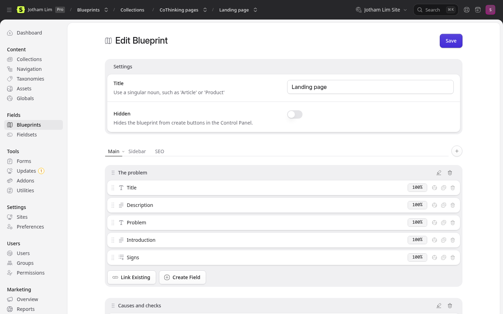
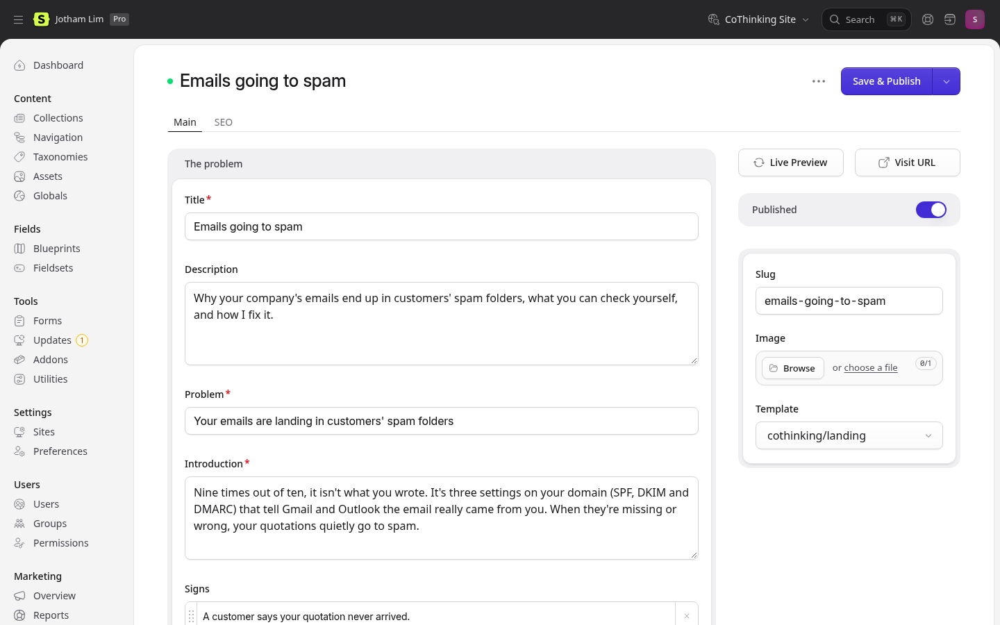
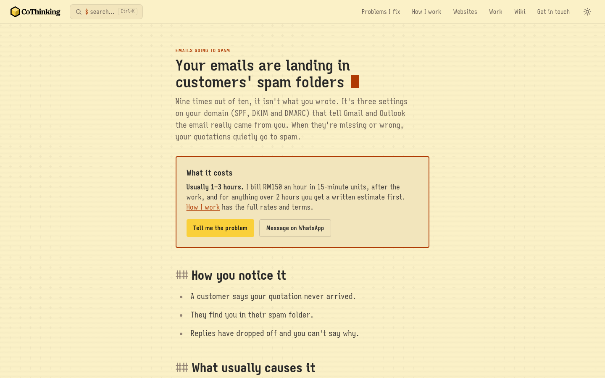
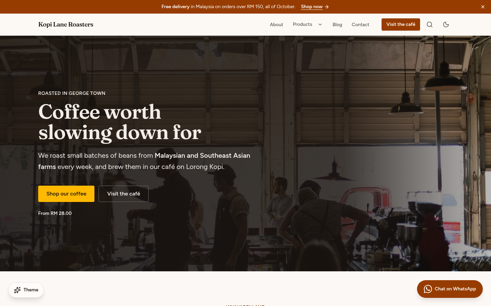
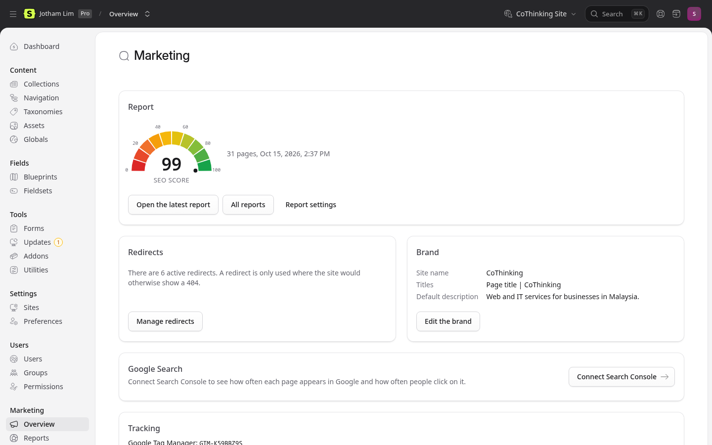

Most owners expect WordPress or a hosted website builder. I build on BLaST (Blade, Laravel, Statamic, and Tailwind) because of what you live with after launch:

- your staff can update the site themselves;
- the yearly costs are lower and easier to predict;
- there are fewer third-party plugins to go wrong;
- any Laravel developer can open the site and carry on.

The full case, written for owners and for other developers, is below.

I have built websites for seven years, and I have tried many stacks along the way, from WordPress and hosted website builders to Next.js and Astro.

You learn quickly that there is no perfect stack. I like the simplicity of static site generators, but they are impractical for client sites that need forms, enquiries that are tracked, or a catalogue that staff update themselves.

Most small businesses gravitate towards WordPress or a hosted website builder, or now try to vibe-code their own site, believing it is the cheapest and simplest option. After seven years and most of the common stacks, I now build client sites on BLaST. This essay explains why.

## What BLaST is

BLaST stands for Blade, Laravel, Statamic and Tailwind.

A quick rundown:
- Laravel is a widely used framework for building websites and web applications, written in PHP, the same language as WordPress.
- Statamic is a content management system built on top of Laravel, which gives a business the screens it needs to run its own site: pages, products, articles, forms and a media library.
- Blade and Tailwind control how the frontend looks.

BLaST is a flexible stack. It can be as simple as a typical marketing website that lets staff build their own pages, in Markdown files or with a page builder. And when a project needs to scale, it can grow into a full TALL-stack application, because the site is a Laravel application at its core.

## Simpler to use, from the client's point of view

Innov8tif and Pixaproof both started with WordPress websites, managed by a third party. The sites were buggy and did not work well on mobile, so we rebuilt them in-house. I was the marketing manager for both at the time, and the in-house webmaster was me.

We first tried Bricks Builder on WordPress, but it still was not user-friendly for the marketing team. A mistyped class could break the site, and it needed a pile of extra plugins, like Meta Box, FluentSMTP, Wordfence and a backup system, to work properly.

We then quickly shipped the project in Laravel, and website changes fell to me. Management only needed to send a request, and I would update the site with a quick edit to a Blade file and a simple git push and deploy.

But management was worried about autonomy and handover, and wanted any staff member to be able to create and change pages. Statamic made a lot of sense: its interface is as familiar as WordPress, without the bloat, and it was easy to refactor from TALL to Statamic.

Looking back, we had tried most of the options this essay compares before we settled on one.

Now that both sites run on BLaST, their staff make most of these edits themselves and come to me for work that requires a developer. The sites are more consistent, and much of the custom and dead code is gone.

More importantly, both companies have peace of mind. They feel they own and control their site, even though, technically, they always did.

Ultimate Circle had similar needs for its product catalogue, which I used to update on its behalf. Since then, I have moved most of my Laravel projects to BLaST.

Many small businesses want to depend less on outside contractors, and I would rather design for that than fight it.

Below is a preview. Each content type has a blueprint: a set of fields that staff fill in to produce a page.







When the business needs a new kind of content, such as case studies or job openings, it can add a new collection with its own blueprint in the control panel and start adding entries straight away, without any deployment step. Someone with a little technical confidence can do it without a developer.

## Cheaper to host and run

For most small businesses, Statamic Core, the free edition, is enough. The running cost is the server, which my Care Plans include. Core allows one person to manage the site and one enquiry form, which covers most of the clients I work with.

When a project does need the paid edition, Statamic Pro, for several editors or a site in more than one language, it costs USD 349 per site, including a year of updates, then USD 99 a year. Statamic also has a purchasing power parity (PPP) programme; discounts vary by country, so it is best to ask their support team.

On a hosted website builder, the business rents its website instead: the monthly fee continues for as long as the site is up, and the site cannot be moved elsewhere, or at least not without significant effort. Most small businesses end up rebuilding from scratch instead.

A typical WordPress site, on the other hand, pays for each job separately. Here is what the plugins from the Innov8tif story, and a few common ones, cost for a single site:

| What the site needs | Typical WordPress plugin, per year | On BLaST |
|---|---|---|
| Page builder | Bricks Builder: USD 79 | Built into Statamic; Penang, if you want ready-made sections: USD 99 once |
| Custom fields | Meta Box: USD 49 | Built in (blueprints) |
| Forms | Gravity Forms: USD 59 | Built in |
| SEO | Yoast SEO Premium: USD 118.80 | Marketing Toolkit: free |
| Backups | UpdraftPlus Premium: USD 70 | Laravel packages: free |
| Sending email | WP Mail SMTP Pro: USD 99 (USD 49 in the first year) | Built into Laravel |
| **Total** | **About USD 475 a year** | **USD 0, or USD 99 once with Penang** |

*Single-site prices from each vendor's pricing page as of 15 October 2026, before tax. Hosting is not included on either side.*

Even Statamic Pro, at USD 99 a year after the first, costs a fraction of that. And each of those plugins is billed separately, by a vendor free to change its pricing model at any moment.

That is one reason some local web developers turn to nulled plugins.

## Safer to operate and run

Nulled plugins are pirated copies of premium plugins: the paid versions, cracked and passed around for free. They are also one of the most common ways to plant a backdoor on a site. The worst case I have seen was a site I inherited, where the previous vendor had installed them without telling the owners, and it had vulnerabilities. As far as I could tell, nothing had been exploited yet, but only by chance.

It is an extreme case, but it grows out of how WordPress works. Bricks Builder needed several extra plugins at Innov8tif, and that is typical: almost everything is a plugin, and every plugin is one more piece of someone else's code running on your site:

- **More plugins than you think.** Basic tasks need one, and some of the most popular plugins exist only to switch WordPress features off. Classic Editor, which brings back the editor WordPress replaced in 2018, is one of them.
- **Plugins that grow on you.** Many are commercial, sell their features in tiers, and get heavier with every release. The paid ones are exactly what gets nulled.
- **Outdated software underneath.** On 19 October 2026, [WordPress.org's own statistics](https://wordpress.org/about/stats/) showed that about 36 per cent of the sites reporting to it ran on versions of PHP that no longer receive security fixes.

On BLaST, there are far fewer moving parts. Most of what a business site needs is already in Statamic, the few extra packages come from known publishers, and updating them is one command. The current version of Laravel will not even install on a version of PHP that has stopped receiving security fixes.

Most small businesses know WordPress. Knowing it well does not make it simpler or safer to run.

## Not locked in to me

A website should outlive your relationship with whoever built it. That was exactly what worried management at Innov8tif and Pixaproof.

Statamic has its own templating language, Antlers, and I built my first Statamic site with it. I now use Blade instead, because Blade is what every Laravel developer already knows. Laravel is already a niche within web development, and Statamic is a niche within Laravel. I would rather not add a third.

Any Laravel developer can open the site and carry on.

## Vibe-coding a site yourself

A site vibe-coded by someone who is not a developer can feel like magic at first. Building something serious this way still means deciding where it runs and how it is backed up, and those decisions take experience. The owner has to settle questions like these:

- Where is it hosted, and who pays for it?
- How is it backed up?
- Who can sign in?
- What happens when the enquiry form quietly stops sending?

This is where AI meets its limits for small businesses. Even if frontier models were twice as smart, they could not make the decisions an owner has to make about their own business. When time and attention are short, handing the website to someone you trust is often the better use of both. AI, however powerful, adds to the load when the owner is left to use it alone.

AI-assisted development is a different thing: a developer uses the same tools, but knows what to ask for and checks what comes back. BLaST suits this well, because the design, templates and content structure are ordinary files rather than settings buried in a database. When a client asks for every blue button to match a new brand colour, or for a section to be reused across pages, the change takes hours rather than days, and I can review every line before it goes live.

## For developers

If you build sites for clients, the useful question is not which stack you enjoy, but what your client has to live with after you hand it over:

- Who edits the site?
- What does it cost each year?
- Who maintains it when you move on?

That is the case for BLaST. And your templates stay readable to any Laravel developer:

```blade
<x-layout :page="$page">
    <ul class="grid gap-6 md:grid-cols-3">
        <s:collection from="products" sort="order" limit="6">
            <li class="rounded-lg bg-card p-6">
                <a href="{{ $url }}" class="font-semibold text-primary">{{ $title }}</a>
            </li>
        </s:collection>
    </ul>
</x-layout>
```

If you want to try it, start with Statamic itself and its documentation. For the parts that come up in almost every client project, I publish two packages:

- **[Penang](https://statamic.com/starter-kits/jothamlec/penang)**, a starter kit on the Statamic Marketplace (USD 99 per site, one-time). It runs on the free edition and gives editors a page builder with twenty sections, five themes, products with links to Shopee and Lazada, a blog, a team page, an enquiry form and WhatsApp buttons, in English, Malay and Chinese.
- **[Marketing Toolkit](https://statamic.com/addons/jothamlec/marketing-toolkit)**, free and open source. It handles page titles and descriptions with a search preview, sitemaps, redirects that are added when a page moves, a log of missing pages, SEO reports and Google Tag Manager, all edited by the marketing team, not the developer.





And if you would rather have the site built for you, that is what I do at [CoThinking](https://cothink.ing).

## When BLaST is the wrong choice

BLaST suits websites. It is not for everyone:

- **You need an app, not a website.** If accounts, dashboards and workflows are at the centre, Laravel on its own is a better fit.
- **You want a fully free and open-source stack.** Statamic is commercial software, so look elsewhere.
- **You are already deep in WordPress.** If you have paid for lifetime licences and built your processes around them, switching may cost more than it saves.

There is still no perfect stack, but in my experience BLaST suits most small businesses. Their own staff can run the site, and its yearly cost is predictable. If they ever change developers, the next one can pick it up without starting again.
