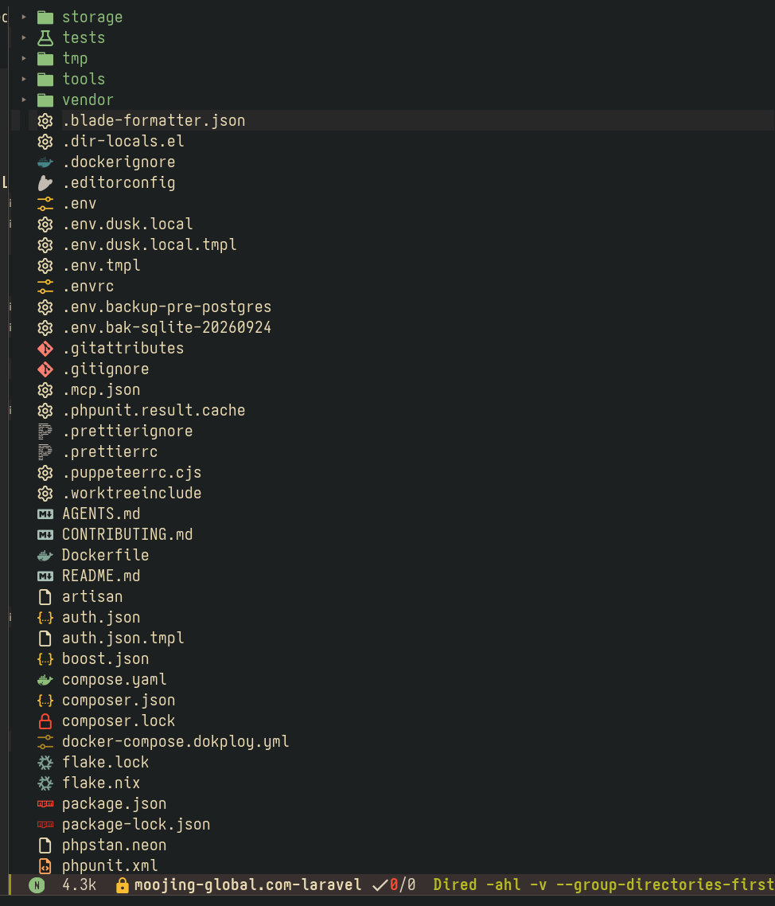

I started learning Laravel around 1.5 years ago and have completed roughly 5–6 projects with it. I leaned heavily on agentic coding at the start, and it upsets me how little I understood of what was going on.

I've tried approaching the learning from three separate levels, ranked by how effective each has been:

1. Domain knowledge
2. Top-down
3. Bottom-up

Before Laravel, I was more proficient with Linux, Emacs and server hosting, and I have a background in SEO. I'm more comfortable hosting Laravel and setting up LSPs, formatters and linters for a project than I am writing the code itself. The code may be a black box, but at least I understand the project from a high level — I'm confident that backups work as intended, and I get notified if anything 404s.

Learning Laravel by learning PHP first was the worst approach. I had no prior knowledge to latch onto, and it took a lot of work just to get basic functionality working — only to replicate a WordPress feature that a single toggle switch would have solved.

I appreciate something in between. Laracasts' *Laravel From Scratch* series struck that balance: enough abstraction to stay productive and keep the LOC low, but verbose enough that I wasn't swept away by Laravel's "magic".

I'm now at the point where I can read Laravel code and modify or tune it as I please, but I can't write it from scratch. It's like any other language — I can read and understand it, but I fail to write it, and I babble like a baby.

But I know learning compounds. Once I'm comfortable with Laravel, Filament should be a cakewalk, then AstroJS, then VueJS.

So far, I think I'm striking a good balance: vibing and shipping enough to stay productive, slowing down enough to build understanding, and staying patient enough to enjoy the work I'm doing.

