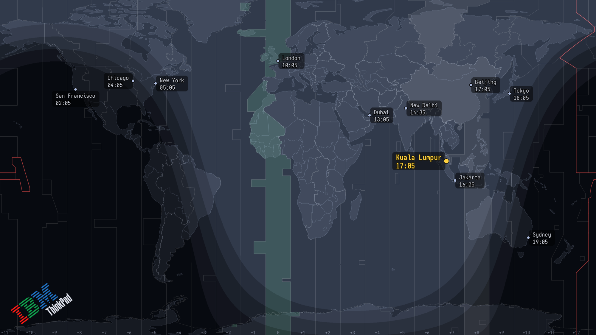

A live world-time wallpaper for Wayland and X11: a world map, clocks for your cities, your home city marked, and a day/night terminator that tracks the sun. It recreates the IBM ThinkPad "World Time" Active Desktop for the Linux desktops I use now.

```sh
pipx install greyline
greyline init
greyline city add "Kuala Lumpur" 3.14 101.69 Asia/Kuala_Lumpur --home
```

There is no daemon. A systemd timer runs greyline once a minute, and it renders a PNG per output, hands each to the wallpaper tool you already use, and exits. Thirty-five themes ship, most of them base16 ports, so the wallpaper matches your editor and terminal, and the help pages are generated from the same files the renderer reads, so they cannot describe a version you do not have.

`sun.py` computes the subsolar point and the terminator, `vectormap.py` draws Natural Earth GeoJSON, and `render.py` composites them and places each clock label where it avoids its neighbours. Only the backends are platform-specific, which is why the same renderer runs in the browser demo.

The changelog follows Keep a Changelog, and each entry explains the reasoning. From 0.8.6:

> Each band was drawn from a single boundary latitude per column, and one latitude is not enough to say which side of it is dark: reading down a meridian the sun sinks toward the midnight point and climbs again beyond it, so a level like −18° is crossed twice, and taking only the first crossing shaded everything past it. Each band is now the exact interval between both crossings.

greyline is GPL-2.0-or-later. It descends from a GPL tribute, the concept and artwork are IBM's and Lenovo's, and the NOTICE and CREDITS files say what came from where. It is in beta at 0.8.6 after 21 releases, and I run it daily on sway.

## Links

- [Repository](https://github.com/Jotham-LEC/greyline) and [wiki](https://github.com/Jotham-LEC/greyline/wiki)
- [PyPI](https://pypi.org/project/greyline/)
- [Browser demo](https://jotham-lec.github.io/greyline/)
