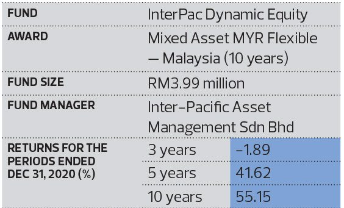

This article first appeared in Wealth, The Edge Malaysia Weekly on April 19, 2021 - April 25, 2021

Inter-Pacific Asset Management Sdn Bhd’s (InterPac) InterPac Dynamic Equity fund won the award for Best Mixed Asset MYR Flexible (Malaysia) in the 10-year category. The fund generated a total return of 55.15% during the period.

CEO Datuk Dr Nazri Khan says the team’s dynamic and tactical investment strategy, as well as a combination of well-executed fundamental and technical analysis, were key contributors to the fund’s success. “Compared with the traditional approach of buying stocks at low prices and selling them at their peak, we took a calculated risk in managing our investment activities, which is a combination of fundamental and technical analysis. This non-traditional strategy has set us apart from our peers by a large margin.

“Through fundamental analysis, we identify and determine the value and growth rate of the stock. Technical analysis allows us to understand market behaviour and capture opportunities at the right time according to developments in trends.”

According to the information on the fund, InterPac Dynamic Equity seeks to maximise capital gains by investing principally in local stocks. It has a flexible asset allocation strategy that enables it to invest in fixed-income securities and money market instruments to meet its objectives over the medium to long term.

Nazri points out that one of the largest hurdles his team had to overcome last year was the uncertainty caused by the Covid-19 outbreak. “The CBOE Volatility Index (VIX) hit its historical high in 2020 — an indication that global market players were on hold, due to a fear of uncertainty. However, to us, we saw opportunities in the situation. We made the uncommon decision to be more proactive by allocating assets to technology, consumer and healthcare stocks,” he says.

“Our major concern was to maintain our positive returns and retain investors. There were times when we faced difficulties as the market experienced minor corrections. However, it has not affected our overall strong performance as we have policies to minimise risks and secure early profits.”

Nazri says that as CEO, it was not easy to execute the trading plans. There were times when the team had to go the extra mile and be more innovative in discovering investment opportunities in the midst of uncertainty.

Hence, he highlights the importance of being accountable as the leader of the investment team — to be proactive and firm in making decisions that will benefit everyone and to display proper leadership and motivate everyone on the team.

Despite the challenges, Nazri is bullish on the outlook for the next 12 months. He points out that the FBM KLCI has breached the 1,600-point threshold — indicating a V-shaped economic recovery.

“The pandemic should be over soon, especially after the rollout of the vaccination programmes. Governments around the world are vaccinating their people in stages, which is a key factor in reopening business activities, especially in the tourism and aviation sectors,” he says.

“Understanding this gives us an advantage in positioning ourselves in promising

shariah-compliant stock selections with great potential at an early stage, in order to garner the maximum potential returns. We are optimistic and look forward to more positive developments in the market.”
