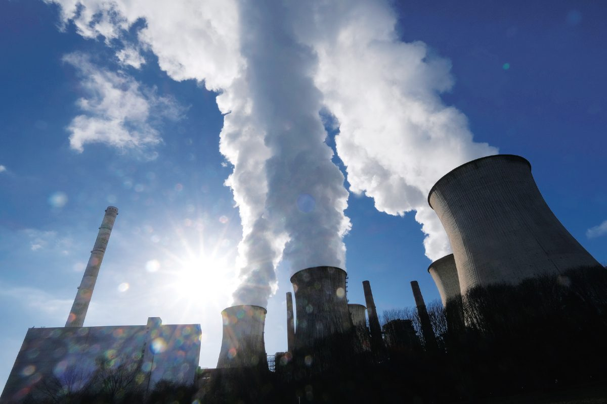

This article first appeared in Personal Wealth, The Edge Malaysia Weekly on August 10, 2020 - August 16, 2020

## In a nutshell

Transition bonds are a relatively new class of bonds that aim to help companies in industries with high greenhouse gas (GHG) emissions — dubbed “brown industries” — raise capital specifically to finance decarbonisation activities. These bonds are not to be confused with green bonds, which are designed specifically for players in green industries, such as hydropower or solar power providers, and are not accessible by brown companies.

According to a December 2019 report by BNP Paribas, the need for transition bonds comes from the growing societal and governmental pressure for brown companies to shift to less brown business activities whenever possible as part of the 2015 Paris Accord, which aims to limit global warming to 1.5°C above pre-industrial levels.

The transition bond market is still considered nascent. Due to the relatively new entry of this classification of bonds, there has been a lack of globally accepted definitions and verifications of these bonds. Thus, it is difficult to determine the market size of the industry.

However, according to a report by the UK-based Climate Bonds Initiative, there had been a total of seven global transactions that raised about US$3.5 billion (RM14.8 billion) by end-June. This is in stark contrast to the US$255 billion worth of global green bonds issued in 2019.

## Companies that have issued transition bonds

Marfrig Global Foods SA, which is headquartered in São Paulo, was the first issuer to officially use this particular label of bonds in September last year. The beef producer, one of the largest in the world, issued the US$500 million 10-year sustainable transition bond at a coupon rate of 6.625% to raise funds to source cattle from the Amazon Biome, where cattle farmers in the region have to meet the sustainable sourcing protocol.

According to the press statement, all cattle farmers must reiterate the commitment to not use slave, forced or child labour for their business operations or raise cattle in indigenous reserves, conservation units, blacklisted areas or deforestation areas. According to The Financial Times, the bond issued by Marfrig saw a huge take-up by investors, who subscribed for three times the amount on offer.

Another recent example would be the US$350 million Energy Transition Bond issued by Hong Kong-based Castle Peak Power Company Ltd on June 16, which will be used to finance the construction of an offshore liquefied natural gas receiving terminal and its associated infrastructure in Hong Kong waters. This bond is expected to reduce the Hong Kong government’s reliance on coal-fired power generation in exchange for gas-fired power generation, which is much more sustainable.

## Growing industry

This class of bonds is expected to grow substantially due to the combination of several factors, according to a BNP Paribas report. One is a huge demand for a market-based solution to sustainable finance in general, driven by European corporate and sovereign green bonds.

As the environmental, social and governance (ESG) strategy shifts from being a gauge of corporate social responsibility to a significant driver of investments, transitional bond issuance will play a major role in this space. The report predicts that the transition market will outgrow the bond market by the mid-2020s.

“There will also be more choices on the greener targets linked to transition issuance. These may be lower GHG emissions set at the company level or broader targets tied to the nationally determined contributions (NDC) under the Paris Accord or the UN’s Sustainable Development Goals,” says the report.

“[Transition bonds] will also reduce the risk of ‘greenwashing’ — claims that a company is more eco-friendly than it really is — creating more confidence in the ability of brown industries to convert to a greener business and in the transition market. This will allow green bonds to retain their ‘purity’ as capital set aside for purely green business activities.”

## The challenges

Transition bonds have been heavily criticised by climate-change activists and publications for the lack of rules governing the usage of the label. Some argue that the asset class is open to abuse by both banks and issuers looking to earn fees, or use the bonds as credentials to present as being more sustainable than they actually are.

Francesca Suarez, head of ESG research at Mirova, was quoted in a report as saying that some issuers may use the funds raised to pay for routine upgrades, without trying to make significant changes to the company’s carbon footprint. There is a very high risk of greenwashing that really needs to be paid attention to, she points out.

Currently, there is no standardised framework for issuing transition bonds, although several companies such as AXA Investment Managers and Cadent have come up with their own frameworks. Sustainalytics, a subsidiary of Morningstar, also offers services to assess transition bond frameworks and provide second-party opinions and evaluations on the use of the proceeds, eligibility criteria and projects eligible for the funding.

At the time of writing, no Malaysian company had issued transition bonds.
